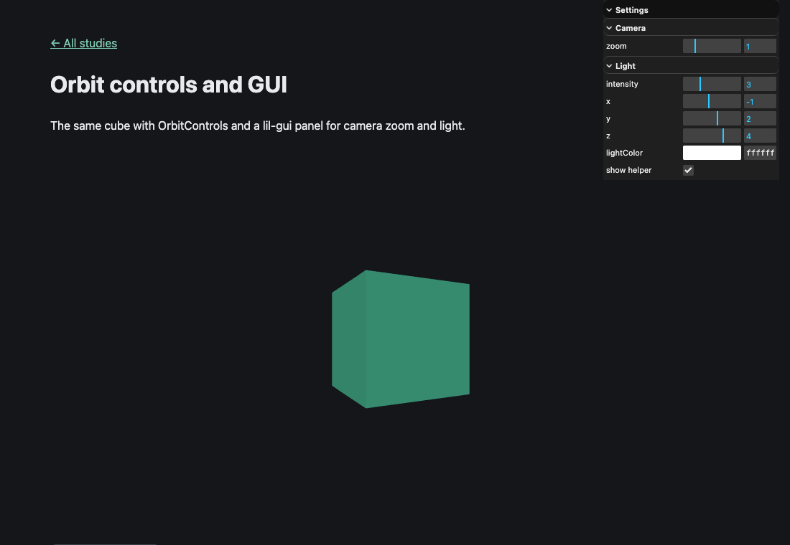

# three-studies

Small, self-contained TypeScript studies of [three.js](https://threejs.org) fundamentals, built with Vite.



## Studies

| Study | What it shows |
| --- | --- |
| [Basic scene](studies/basic-scene/) | Renderer, perspective camera, directional light, and a spinning cube. |
| [Orbit controls and GUI](studies/orbit-controls/) | `OrbitControls` with damping and a [lil-gui](https://lil-gui.georgealways.com) panel for camera zoom and light intensity, position, colour and helper. |

Shared plumbing lives in `src/lib/`: `stage.ts` (renderer, resize, pause, teardown), `constants.ts` (named values) and `cube.ts`.

## Accessibility and performance

- The canvas has a text alternative (`role="img"` + `aria-label`) and is keyboard focusable.
- A pause/play button (also Space on the focused canvas) controls the animation.
- `prefers-reduced-motion: reduce` starts the animation paused.
- Orbit study: arrow keys pan when the canvas is focused.
- Resizes with its container; pixel ratio is capped at 2.
- The animation loop stops while paused and everything is disposed on teardown.

## Develop

Requires Node 20.19+ (CI uses 22).

```sh
npm install
npm run dev        # dev server
npm run lint
npm run build      # type-check + production build into dist/
npm run preview    # serve dist/
```

## Deploy

The CI workflow (install, lint, build, deploy `dist/` to GitHub Pages from `main`) could not be pushed with the available token; see the PR description. Enable Pages under Settings > Pages > Source: GitHub Actions. Assets use relative paths, so it works under a repo subpath.
